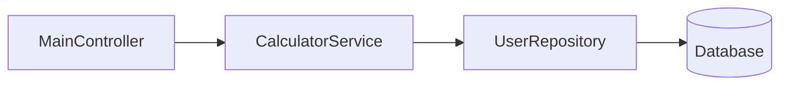

# FlexiTech Fx Framework 🌱

A lightweight, annotation-based dependency injection framework for Java with simple conventions and good developer ergonomics.

## Features ✨
- Component registration through annotations
- Constructor, field and factory-method dependency injection
- Dependency-ordered initialization with circular dependency detection
- Component lifecycle management (`@OnInit`, `@PreDestroy`)
- Auto-component scanning (directory and JAR)
- Properties management with profiles
- Persistent data storage

## Modules ✨
- API Client 🔥 [api-client](https://github.com/itech-framework/api-client)
- JavaFX 🔥 [java-fx](https://github.com/itech-framework/java-fx)
- JPA 🔥 [itech-jpa](https://github.com/itech-framework/jpa)

## Demo Applications
- [Daily Planner Application - Framework version 1.0.11+Latest](https://github.com/itech-framework/daily-planner)
- [Task Management Application - Framework version 1.0.1](https://github.com/itech-framework/demo)

## Getting Started 🚀

### Requirements
- Java 17+

### Installation
Add to your project via Maven:
```xml
<dependency>
   <groupId>io.github.itech-framework</groupId>
   <artifactId>core</artifactId>
   <version>1.0.12-RC1</version> <!-- Latest version -->
</dependency>
```

### Example Usage

Create the main application class:
```java
@ComponentScan(basePackage = "org.itech.framework.test")
public class Main {
    public static void main(String[] args) throws Exception {
        ITechApplication.run(Main.class);
    }
}
```

Define a presentation component:
```java
@Presentation
public class MainController {
    @Use
    private CalculatorService calculatorService;

    @OnInit
    public void initialized() {
        System.out.println("5 + 5 = " + calculatorService.plus(5, 5));
    }
}
```

`@Use` injects another component into the field. `@OnInit` runs after the component has been created and its dependencies have been injected.

> 📌 **Note**: `@Presentation` is a component with a higher level. See [Component Levels](#component-levels) for the different levels.

### Business Service Example 💡

```java
public interface CalculatorService {
    int plus(int a, int b);
}

@Service
public class CalculatorServiceImpl implements CalculatorService {
    @Use
    private UserRepository repository;

    @Override
    public int plus(int first, int second) {
        return first + second;
    }
}
```

**Breakdown:**

1. `CalculatorService` is the contract. Injection points depend on the interface.
2. `@Service` registers the implementation at the business level (level 1). It is discovered and instantiated automatically.
3. `@Use` injects `UserRepository` (a data access component).
4. The framework registers the implementation under its interface name, so `@Use CalculatorService` resolves to `CalculatorServiceImpl`.

**Dependency flow:**


> 📌 **Recommendation**: prefer interface-based services. They are easier to test, keep contracts explicit and keep components loosely coupled. Classes without an interface also work.

## Annotations Reference 🔖

### Component Scanning
```java
@ComponentScan(basePackage = "org.itech.framework.test", properties = {"application.properties"})
public class Main { ... }
```
**Attributes**:
- `basePackage`: the package the framework scans (including sub-packages) for components.
- `properties`: properties files to load. Defaults to `application.properties` on the classpath.

### Component Registration

| Annotation       | Target | Level | Attributes | Description                                  |
|------------------|--------|-------|------------|----------------------------------------------|
| `@DataAccess`    | Class  | 0     | -          | Repositories, DAOs                           |
| `@Service`       | Class  | 1     | -          | Business logic services                      |
| `@Presentation`  | Class  | 2     | -          | Controllers, UI handlers                     |
| `@Component`     | Class  | 3     | `name`     | General purpose components, utilities        |
| `@Configuration` | Class  | 3     | -          | Classes that define components via methods   |

> ⚠️ `@BusinessLogic` is deprecated and will be removed. Use `@Service`.

Component names default to the fully qualified class name. Use `@Component(name = "...")` to set a custom name.

### Dependency Injection

```java
@Use
private UserService userService;

@Use(name = "userService")
private UserService namedService;

@Use(share = false)
private ReportBuilder reportBuilder;
```

**Attributes**:
- `name`: inject the component registered under this name (optional).
- `share`: `true` (default) injects the shared singleton. `false` creates a new instance for every injection point. A new instance gets its own dependencies injected and its `@OnInit` methods run, but its `@PreDestroy` methods are not tracked.

**Constructor injection** is supported. The framework uses a constructor annotated with `@DefaultConstructor`, otherwise the no-arg constructor, otherwise the constructor with the most parameters it can fully resolve:
```java
@Service
public class OrderService {
    private final OrderRepository repository;
    private final int pageSize;

    public OrderService(OrderRepository repository, @DefaultParameter("20") int pageSize) {
        this.repository = repository;
        this.pageSize = pageSize;
    }
}
```
- `@DefaultConstructor`: marks the constructor the framework must use.
- `@DefaultParameter("value")`: a fallback value for a constructor or `@OnInit` parameter when no component matches.

### How Components Are Resolved

For `@Use` fields and constructor parameters, the framework looks for a component in this order:

1. The component registered under `name` (or under the field's type name if no `name` is given).
2. A component whose simple class name matches `name`.
3. If no `name` is given, the one component whose type is assignable to the field type.

If more than one component matches, startup fails with a message asking you to choose with `@Use(name = "...")`.

Each component is also registered under the interfaces it implements, unless the class is annotated with `@IgnoreInterfaces`. Two components cannot be registered under the same interface or the same name.

### Configuration Classes

Use `@Configuration` to create components from methods, for example to wrap third-party objects:

```java
@Configuration
public class AppConfig {
    @Property(key = "api.url")
    private String apiUrl;

    @Component
    public HttpClient httpClient() {
        return new HttpClient(apiUrl);
    }

    @Component(name = "retryPolicy")
    public RetryPolicy retryPolicy(HttpClient client) {
        return new RetryPolicy(client, 3);
    }
}
```
- The configuration class has its fields injected and `@OnInit` methods run before its component methods are called.
- Method parameters are resolved like constructor parameters, so one method can depend on another.
- A component method must not return `null`.
- The component is registered under its name (the `@Component` name, or `ClassName.methodName`), its return type and the interfaces of its runtime class.

### Component Lifecycle

```java
@OnInit(order = 1)
private void initialized() {
    System.out.println("Component is initialized!");
}

@PreDestroy
public void cleanup() {
    // release resources
}
```
- `@OnInit` methods run after the component's fields are injected. `order` sorts multiple init methods within one component (lowest first). Init methods may declare parameters, which are resolved as components or `@DefaultParameter` values.
- `@PreDestroy` methods run when the application shuts down.

**Order guarantees:**
- A component is always initialized **after** the components it depends on (constructor, factory method and shared `@Use` dependencies).
- Components that don't depend on each other are initialized by level (0 → 3), then by registration order.
- At shutdown, `@PreDestroy` methods run in the **reverse** of the initialization order, so a component is destroyed before the components it depends on.

### Circular Dependencies
- **Constructor / factory method cycles** are detected at startup and fail with the full chain, for example `Circular dependency detected: demo.X -> demo.Y -> demo.X`.
- **Field (`@Use`) cycles between shared components** are allowed. Both instances exist before fields are injected.
- Cycles through `@Use(share = false)` are detected and fail.

### Other Annotations
- `@IgnoreInterfaces`: don't register the component under its interfaces.
- `@DisableLoaded`: the component is created and registered but its fields are not injected and its lifecycle methods are not run. Use it for components you configure manually later.

### Properties Management
```properties
application.name=Test Flexitech Framework
```
```java
@Property(key = "application.name")
private String applicationName;
```
**Attributes**:
- `key`: the property key.
- `defaultValue`: the value used when the key is missing (optional). Without it, a missing key fails startup.

Supported field types: `String`, primitives and their wrappers, and enums.

#### Profiles
The active profile is read from the `flexi.profiles.active` system property, then from the `flexi.profiles.active` key in the base properties file, and defaults to `dev`. For every base file the framework also loads an optional override file named `<name>-<profile>.properties` (for example `application-dev.properties`), which takes precedence.

```bash
java -Dflexi.profiles.active=prod -jar app.jar
```

### Data Storage
```java
@DataStorage(key = "authenticated", defaultValue = "false")
private boolean authenticated;
```
**Attributes**:
- `key`: the storage key (defaults to the field name).
- `defaultValue`: the value when nothing is stored yet (optional).

The value is loaded from storage when the component is initialized. Values are persisted with `java.util.prefs.Preferences` by default.

To persist a change:
```java
DataStorageUtil.save("authenticated", true);
```
`DataStorageUtil.save` updates every component field bound to that key and writes it to storage. `DataStorageUtil.load(key)` and `DataStorageUtil.load(key, Class)` read values.

To use a different backend, provide your own `DataStorageService` component. It replaces the default one.

### Enabling Modules
Put these on your main class when you use the matching module:
- `@EnableJavaFx`: requires the [java-fx](https://github.com/itech-framework/java-fx) module.
- `@EnableJPA`: requires the [jpa](https://github.com/itech-framework/jpa) module. If you have `@Entity` classes in the scanned package and JPA is not available or not initialized, startup fails with a message explaining why.
- `@EnableApiClient`: requires the [api-client](https://github.com/itech-framework/api-client) module.

## Component Levels

Components are layered by level. Level controls the initialization order of components that don't depend on each other. Dependencies always win over levels.

| Level | Constant               | Annotation       | Typical Use Case              |
|-------|------------------------|------------------|-------------------------------|
| 0     | `DATA_ACCESS_LEVEL`    | `@DataAccess`    | Repositories, DAOs            |
| 1     | `BUSINESS_LOGIC_LEVEL` | `@Service`       | Services, core logic          |
| 2     | `PRESENTATION_LEVEL`   | `@Presentation`  | Controllers, UI handlers      |
| 3     | `DEFAULT_LEVEL`        | `@Component`     | Utilities, general components |

```txt
Data Access (0) → Business Logic (1) → Presentation (2) → Default (3)
```

## Migrating from `@Rx` and `@BusinessLogic`

| Old              | New        |
|------------------|------------|
| `@Rx`            | `@Use`     |
| `@Rx(name = "x")`| `@Use(name = "x")` |
| `@BusinessLogic` | `@Service` |

Search your project for `@Rx` before upgrading. Fields still annotated with it are no longer injected.

## 🤝 Support
For assistance:  
📧 Email: `itech.saizawmyint@gmail.com`  
📑 [Open an Issue](https://github.com/itech-framework/fx/issues)

---

*Made with ❤️ by the FlexiTech Team*