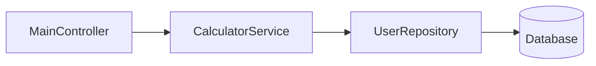

# FlexiTech Fx Framework 🌱

A lightweight, annotation-based dependency injection framework for Java with simple conventions and good developer ergonomics.

## Features ✨
- Component registration through annotations (a stereotype built on `@Component` also works, one meta-annotation level deep)
- Constructor, field and factory-method dependency injection
- Dependency-ordered initialization with circular dependency detection
- Component lifecycle management (`@OnInit`, `@PreDestroy`), including methods declared in superclasses
- Auto-component scanning of directories, JAR files and `jrt:` runtime images, with `excludePackages`
- Properties management with profiles (system property, environment variable or file)
- Persistent data storage with a replaceable backend
- An `ApplicationContext` that can be closed, with a clean rollback when startup fails
- Optional modules for JavaFX, JPA and the API client

## Modules ✨
- API Client 🔥 [api-client](https://github.com/itech-framework/api-client)
- JavaFX 🔥 [java-fx](https://github.com/itech-framework/java-fx)
- JPA 🔥 [itech-jpa](https://github.com/itech-framework/jpa)

Use the same framework version for the core and for every module.

## Demo Applications
- [Daily Planner Application - Framework version 1.0.11+Latest](https://github.com/itech-framework/daily-planner)
- [Task Management Application - Framework version 1.0.1](https://github.com/itech-framework/demo)

## Getting Started 🚀

### Requirements
- Java 17+

### Installation
Add to your project via Maven. Use version 1.1.0 or later:
```xml
<dependency>
    <groupId>io.github.itech-framework</groupId>
    <artifactId>core</artifactId>
    <version>${framework-version}</version>
</dependency>
```

### Logging

The framework logs through the Log4j 2 API and does not bring a logging implementation. Add one to your application, for example Log4j Core:

```xml
<dependency>
    <groupId>org.apache.logging.log4j</groupId>
    <artifactId>log4j-core</artifactId>
    <version>2.23.1</version>
</dependency>
```

Without an implementation, Log4j prints `Log4j2 could not find a logging implementation` and the framework logs nothing. If you use Logback, add `log4j-to-slf4j` instead.

### Example Usage

Create the main application class:
```java
@ComponentScan(basePackage = "org.itech.framework.test")
public class Main {
    public static void main(String[] args) throws Exception {
        ITechApplication.run(Main.class);
    }
}
```

Define a presentation component:
```java
@Presentation
public class MainController {
    @Use
    private CalculatorService calculatorService;

    @OnInit
    public void initialized() {
        System.out.println("5 + 5 = " + calculatorService.plus(5, 5));
    }
}
```

`@Use` injects another component into the field. `@OnInit` runs after the component has been created and its dependencies have been injected.

> 📌 **Note**: `@Presentation` is a component with a higher level. See [Component Levels](#component-levels) for the different levels.

### Business Service Example 💡

```java
public interface CalculatorService {
    int plus(int a, int b);
}

@Service
public class CalculatorServiceImpl implements CalculatorService {
    @Use
    private UserRepository repository;

    @Override
    public int plus(int first, int second) {
        return first + second;
    }
}
```

**Breakdown:**

1. `CalculatorService` is the contract. Injection points depend on the interface.
2. `@Service` registers the implementation at the business level (level 1). It is discovered and instantiated automatically.
3. `@Use` injects `UserRepository` (a data access component).
4. The framework registers the implementation under its interface name, so `@Use CalculatorService` resolves to `CalculatorServiceImpl`.

**Dependency flow:**


> 📌 **Recommendation**: prefer interface-based services. They are easier to test, keep contracts explicit and keep components loosely coupled. Classes without an interface also work.

## Annotations Reference 🔖

### Component Scanning
```java
@ComponentScan(
        basePackage = "org.itech.framework.test",
        properties = {"application.properties"},
        excludePackages = {"org.itech.framework.test.legacy"},
        failOnLoadError = true)
public class Main { ... }
```
**Attributes**:

| Attribute | Default | Description |
|-----------|---------|-------------|
| `basePackage` | *(required)* | The package scanned for components, including sub-packages. A blank value means the package of the annotated class. |
| `properties` | `{"application.properties"}` | Property files to load from the classpath. Every listed file is required. Later files override earlier ones. |
| `excludePackages` | `{}` | Packages or classes to leave out. An entry matches the class with that exact name and everything below it as a package (`com.app.legacy` excludes `com.app.legacy.Foo` but not `com.app.legacy2.Foo`). |
| `failOnLoadError` | `true` | `true` stops startup when a scanned class cannot be loaded (for example a missing optional library). `false` skips the class and logs a warning. |

**Startup order:**
1. The listed property files are loaded.
2. The base package is scanned for classes annotated with `@Component` or a stereotype built on it.
3. Components are created, injected and initialized.

**Scanning rules:**
- The annotated class must be the one passed to `ITechApplication.run`. Without `@ComponentScan`, startup fails.
- Startup fails when no class is found in the base package, which usually means a typo in `basePackage`.
- Classes are loaded but not initialized. Every class in the package is loaded, so keep optional-library code out of the scanned package or use `excludePackages`.
- Nested classes are scanned. Anonymous and local classes (`Outer$1`), `module-info` and `package-info` are skipped.
- Directories, JAR files and `jrt:` resources are supported. Any other URL protocol fails with a clear error.

### Component Registration

| Annotation       | Target | Level | Attributes | Description                                  |
|------------------|--------|-------|------------|----------------------------------------------|
| `@DataAccess`    | Class  | 0     | -          | Repositories, DAOs                           |
| `@Service`       | Class  | 1     | -          | Business logic services                      |
| `@Presentation`  | Class  | 2     | -          | Controllers, UI handlers                     |
| `@Component`     | Class, method | 3 | `name`  | General purpose components, utilities. On a method it is only valid inside a `@Configuration` class. |
| `@Configuration` | Class  | 3     | -          | Classes that define components via methods   |

> ⚠️ `@BusinessLogic` is deprecated and will be removed. Use `@Service`.

Component names default to the fully qualified class name. Use `@Component(name = "...")` to set a custom name. A name must be unique inside one application context, and a duplicate stops startup.

Abstract classes and interfaces are skipped. Every component is created once as a shared singleton.

### Dependency Injection

```java
@Use
private UserService userService;

@Use(name = "userService")
private UserService namedService;

@Use(share = false)
private ReportBuilder reportBuilder;
```

`@Use` works on fields, constructor parameters, `@Component` factory method parameters and `@OnInit` method parameters.

**Attributes**:
- `name`: inject the component registered under this name (optional).
- `share`: `true` (default) injects the shared singleton. `false` creates a new instance for every injection point. A new instance gets its own dependencies injected and its `@OnInit` methods run, but its `@PreDestroy` methods are not tracked, so they never run automatically. Circular dependencies through `share = false` fail.

**Constructor injection** is supported. The framework picks a constructor in this order:

1. The constructor annotated with `@DefaultConstructor`.
2. The no-argument constructor, if the class has one.
3. The constructor with the most parameters that can all be resolved (by a component or by `@DefaultParameter`). If two such constructors have the same number of parameters, startup fails and you must mark one with `@DefaultConstructor`.

Because the no-argument constructor wins over resolvable constructors, mark your injecting constructor with `@DefaultConstructor` when a class has both.

```java
@Service
public class OrderService {
    private final OrderRepository repository;
    private final int pageSize;

    @DefaultConstructor
    public OrderService(OrderRepository repository, @DefaultParameter("20") int pageSize) {
        this.repository = repository;
        this.pageSize = pageSize;
    }
}
```
- `@DefaultConstructor`: marks the constructor the framework must use.
- `@DefaultParameter("value")`: a fallback for a constructor, factory method or `@OnInit` parameter when no component matches. If a component matches, the component wins and the value is ignored. A parameter with no component and no `@DefaultParameter` stops startup, including primitives.

### How Components Are Resolved

For `@Use` fields and parameters, the framework looks for a component in this order:

1. **With `name`:** the component registered under that exact key, then a component whose simple class name matches. A simple name shared by several components stops startup, and you must use the fully qualified name.
2. **Without `name`:** the component registered under the field's class or interface name, then the single component whose type is assignable to the field type.
3. If more than one component matches the type, startup fails with a message asking you to choose with `@Use(name = "...")`.
4. If nothing matches, startup fails with a "Missing component" error.

Each component is also registered under the interfaces it directly implements, unless the class is annotated with `@IgnoreInterfaces`. Two components cannot share a name. Two components may implement the same interface, but that interface name then becomes ambiguous and every injection point must use `@Use(name = "...")`. A component that is only reachable through a superclass or an inherited interface is still found by type in step 2.

### Configuration Classes

Use `@Configuration` to create components from methods, for example to wrap third-party objects:

```java
@Configuration
public class AppConfig {
    @Property(key = "api.url")
    private String apiUrl;

    @Component
    public HttpClient httpClient() {
        return new HttpClient(apiUrl);
    }

    @Component(name = "retryPolicy")
    public RetryPolicy retryPolicy(HttpClient client) {
        return new RetryPolicy(client, 3);
    }
}
```
- The configuration class has its fields injected and `@OnInit` methods run before its component methods are called.
- Only methods declared directly in the configuration class are used, not inherited ones.
- Method parameters are resolved like constructor parameters, so they may use `@Use` and `@DefaultParameter`, and one method can depend on another.
- A component method must not return `null`.
- The component is registered under its name (the `@Component` name, or `ClassName.methodName`), its return type and the interfaces of its runtime class. Its level comes from the annotations on the return type, so a third-party object is level 3.

### Component Lifecycle

```java
@OnInit(order = 1)
private void initialized() {
    System.out.println("Component is initialized!");
}

@PreDestroy
public void cleanup() {
    connection.close();
}
```

**`@OnInit`**
- Runs once after the component is created and its `@Use`, `@Property` and `@DataStorage` fields are set.
- Methods run in ascending `order` (default 0, negative values allowed). Methods with the same order run superclass first, then subclass.
- The method can have any visibility. Its parameters are resolved like `@Use` injection, or filled from `@DefaultParameter`.
- An exception thrown by the method stops startup.
- It runs on the thread that started the application. Do not run a blocking loop here, such as a console menu or a server loop, because every other component would wait for it.

**`@PreDestroy`**
- Runs when the `ApplicationContext` is closed or the JVM shuts down, or when you call `ComponentProcessor.destroyInstance(...)`.
- Is tracked only for instances the container initializes itself: shared singletons, factory beans and objects passed to `ComponentProcessor.injectMethods`.
- If a method throws, the remaining shutdown tasks still run, and a `FrameworkException` with the failures attached is thrown at the end.
- There is no call on garbage collection.

`@OnInit` and `@PreDestroy` methods declared in a superclass are used too. If a subclass overrides one, it runs once.

**Order guarantees:**
- A component is always initialized **after** the components it depends on (constructor, factory method and shared `@Use` dependencies).
- Components that don't depend on each other are initialized by level (0 → 3), then by registration order.
- At shutdown, `@PreDestroy` methods run in the **reverse** of the initialization order, so a component is destroyed before the components it depends on. Levels do not change the shutdown order.

### Circular Dependencies
- **Constructor / factory method cycles** are detected at startup and fail with the full chain, for example `Circular dependency detected: demo.X -> demo.Y -> demo.X`.
- **Field (`@Use`) cycles between shared components** are allowed. Both instances exist before fields are injected, but an `@OnInit` method may then see a partner whose fields are not injected yet. Avoid using the other component inside `@OnInit` in a cycle.
- Cycles through `@Use(share = false)` are detected and fail.

### Other Annotations
- `@IgnoreInterfaces`: register the component only under its own key, not under its interfaces. Use it for marker interfaces such as `Serializable`, or when several components share an interface and you do not want the interface name to become ambiguous.
- `@DisableLoaded`: the component is created and registered, but its fields are not injected, its `@OnInit` methods do not run and its `@PreDestroy` methods are not registered. Do those steps yourself when the component is needed, with the helpers below. Keep its constructor light, because it is still constructed at startup.

**`ComponentProcessor` helpers**

| Method | Description |
|--------|-------------|
| `injectFields(Class<?>, Object)` | Injects `@Use`, `@Property` and `@DataStorage` fields into an object you created. |
| `injectMethods(Class<?>, Object, int level)` | Injects the fields, runs the `@OnInit` methods and registers the `@PreDestroy` methods. |
| `runInitMethods(Class<?>, Object)` | Runs only the `@OnInit` methods. |
| `destroyInstance(Class<?>, Object)` | Runs the `@PreDestroy` methods of one instance. |
| `context()` | Returns the active `ApplicationContext`. |

### Properties Management
```properties
application.name=Test Flexitech Framework
server.port=8080
```
```java
@Property(key = "application.name")
private String applicationName;

@Property(key = "server.port", defaultValue = "8080")
private int port;
```
**Attributes**:
- `key`: the property key. Keys are matched exactly as written. Dots are part of the key and do not create nested values.
- `defaultValue`: the value used when the key is missing (optional). Without it, a missing key stops startup with a message naming the key and the field. An empty default means "required".

**Supported field types:** `String`, `char`, all primitives and wrappers, enums (exact constant name), `BigDecimal`, `BigInteger`, `Path`, `File`, `Duration` (ISO-8601, for example `PT5S`), `LocalDate`, `LocalDateTime` and `LocalTime`. Values are trimmed. A boolean must be `true` or `false`. Any other type fails with `UnsupportedOperationException`.

#### Profiles
For every base file the framework also loads an optional override file named `<name>-<profile>.properties` (for example `application-dev.properties`), which takes precedence.

The active profile is resolved in this order:
1. The `flexi.profiles.active` system property.
2. The `FLEXI_PROFILES_ACTIVE` environment variable.
3. The `flexi.profiles.active` key in the loaded property files.
4. The default profile `dev`.

```bash
java -Dflexi.profiles.active=prod -jar app.jar
```

### Data Storage
```java
@DataStorage(key = "authenticated", defaultValue = "false")
private boolean authenticated;
```
**Attributes**:
- `key`: the storage key (defaults to the field name). Keys are not prefixed with the class name, so two fields that share a key share the same stored value.
- `defaultValue`: the value when nothing is stored yet (optional). When it is empty, the field keeps the value it already had.

The value is loaded from storage when the component is initialized. Field types are converted from the stored text or JSON: primitives, wrappers, strings, enums and Gson-serializable objects.

To persist a change:
```java
DataStorageUtil.save("authenticated", true);
```
`DataStorageUtil.save` writes the value and updates every component field bound to that key, including fields declared in superclasses. Saving `null` removes the key.

| Method | Description |
|--------|-------------|
| `DataStorageUtil.save(key, value)` | Saves a value and updates the bound fields. |
| `DataStorageUtil.load(key)` | Returns the stored text as it was written, or `null`. |
| `DataStorageUtil.load(key, Class)` | Returns the stored value converted to the type. |

Strings, characters and enums are stored as plain text. Everything else is stored as JSON.

**Default storage:** values are kept with `java.util.prefs.Preferences`, a per-user, OS-level store. The node is the package of your main application class, so two applications built on the framework no longer share keys. The default service limits a key to 80 characters and a value to 8,192 characters. A longer value is rejected with a `DataStorageException`, and nothing is saved.

**Custom storage:** to use a different backend, provide your own `DataStorageService` component. It replaces the default one. The interface has four methods: `load(String)`, `save(String, String)`, `load(String, Class)` and `save(String, Object)`. `@DataStorage` fields are filled through `load(key, Class)`.

### Enabling Modules
Put these on your main class when you use the matching module:
- `@EnableJavaFx`: requires the [java-fx](https://github.com/itech-framework/java-fx) module.
- `@EnableJPA`: requires the [jpa](https://github.com/itech-framework/jpa) module. If you have `@Entity` classes in the scanned package and JPA is not available or not initialized, startup fails with a message explaining why.
- `@EnableApiClient`: requires the [api-client](https://github.com/itech-framework/api-client) module.

## Application Context and Shutdown 🔌

`ITechApplication.run` returns an `ApplicationContext`:

```java
ApplicationContext context = ITechApplication.run(Main.class);
```

| Method | Description |
|--------|-------------|
| `store()` | The `ComponentStore` that holds the components of this context. |
| `cleanupRegistry()` | The `CleanupRegistry` that holds its shutdown tasks. |
| `close()` | Runs the shutdown tasks once. A second call does nothing. |
| `isClosed()` | `true` after `close()`. |

- The framework registers a JVM shutdown hook once, and it closes the active context. You do not need to call `close()` in a normal application. Call it yourself in tests or when you restart the framework inside one JVM.
- `ComponentStore.current()` and `CleanupRegistry.current()` always point at the active context.
- **Starting again:** a new context is started first, and the previous one is closed after the new one has started successfully. If both hold the same port or file, plan for the short overlap.
- **When startup fails:** the new context is closed, so beans that were already initialized get their `@PreDestroy` calls. The previous context, the component store, the cleanup registry and the loaded properties are restored, and the original exception is rethrown. Any failure while closing is attached to it as a suppressed exception.
- `ITechApplication.run` and `ComponentProcessor.initialize` are synchronized, so only one startup runs at a time.

### Custom shutdown tasks

Register your own cleanup with a priority. Higher priorities run first, and tasks with the same priority run last registered first.

| Constant | Value | Use |
|----------|-------|-----|
| `CleanupRegistry.BEFORE_BEANS` | 100 | Runs before every `@PreDestroy` method. |
| `CleanupRegistry.BEAN_PRIORITY` | 0 | Used by all component `@PreDestroy` methods. |
| `CleanupRegistry.AFTER_BEANS` | -100 | Runs after every `@PreDestroy` method, for example to close a shared pool. |

```java
CleanupRegistry.current().register(pool::shutdown, CleanupRegistry.AFTER_BEANS);
```

## Component Levels

Components are layered by level. Level controls the initialization order of components that don't depend on each other. Dependencies always win over levels, and levels have no effect on the shutdown order.

| Level | Constant               | Annotation       | Typical Use Case              |
|-------|------------------------|------------------|-------------------------------|
| 0     | `DATA_ACCESS_LEVEL`    | `@DataAccess`    | Repositories, DAOs            |
| 1     | `BUSINESS_LOGIC_LEVEL` | `@Service`       | Services, core logic          |
| 2     | `PRESENTATION_LEVEL`   | `@Presentation`  | Controllers, UI handlers      |
| 3     | `DEFAULT_LEVEL`        | `@Component`     | Utilities, general components |

```txt
Data Access (0) → Business Logic (1) → Presentation (2) → Default (3)
```

The constants are in `ComponentProcessor`.

## Common Startup Errors 🛠️

| What you see | Usual cause and fix |
|--------------|---------------------|
| The class is missing `@ComponentScan` | Add `@ComponentScan(basePackage = "...")` to the class you pass to `ITechApplication.run`. |
| No classes found in base package | Check `basePackage` for a typo. |
| Could not load class | A scanned class needs a library that is missing. Add the library, add the package to `excludePackages`, or set `failOnLoadError = false`. |
| Missing component | Nothing matches the field or parameter. Annotate the class, or check the package is scanned. |
| More than one component matches | Choose with `@Use(name = "...")`. A simple name shared by several components needs the fully qualified name. |
| Circular dependency detected | A constructor or factory method cycle. Break it with a field-injected `@Use`. |
| Ambiguous constructors, or no resolvable constructor | Mark the constructor to use with `@DefaultConstructor`, or add `@DefaultParameter` to the parameters that have no component. |
| Property not found | Add the key, or set `defaultValue` on `@Property`. |
| A field uses the removed `@Rx` annotation | Replace `@Rx` with `@Use`. See [Migrating](#migrating-from-rx-and-businesslogic). |
| `DataStorageException` for a key or value | The key is over 80 characters or the value is over 8,192 characters. |

## Notes and Limits 📌
- Do not block inside `@OnInit`. It runs on the starting thread.
- `@Use(share = false)` instances are not tracked, so their `@PreDestroy` methods never run on their own.
- `@PreDestroy` runs on the thread that closes the context, which is a JVM shutdown thread at exit. In a JavaFX application, switch to the UI thread yourself with `Platform.runLater` if a method touches the UI.
- Do not store secrets in `@DataStorage`. `Preferences` is not encrypted.

## Upgrading to 1.1.0 ⬆️

This release changes the public API. Rebuild java-fx, jpa and api-client against it and use the same version for all of them.

**Removed or changed API**
- `ComponentStore` and `CleanupRegistry` are instance classes now. The static methods are gone. Use `ComponentStore.current()` and `CleanupRegistry.current()`, or `ApplicationContext.store()` and `cleanupRegistry()`. The public `components` map is gone. Use `snapshot()`, `getAllComponents()` or `findByType`.
- `CleanupRegistry.addTask` was removed. Use `register(task, priority)`.
- `ITechApplication.run` and `ComponentProcessor.initialize` return an `ApplicationContext`. Code compiled against 1.0.x must be rebuilt.
- `DefaultDataStorageService` needs the application class.
- `@Rx` fields now stop startup. They used to be silently skipped. Replace `@Rx` with `@Use`.
- The framework no longer brings `log4j-core`, `jackson-databind` or `lombok`. Add a Log4j 2 implementation to your application (see [Logging](#logging)).
- The jar has the module name `io.github.itech_framework.core`.

**Behavior changes**
- `@OnInit` and `@PreDestroy` methods declared in a superclass now run. If a base class has such methods, they run now and did not before.
- A `@Use(name = "...")` simple name shared by several components fails instead of using the first one.
- Startup fails when `@ComponentScan` is missing, when no class is found in the base package, and when a scanned class cannot be loaded (see `failOnLoadError`). It also fails on an unsupported URL protocol.
- A constructor, factory method or `@OnInit` parameter that cannot be resolved and has no `@DefaultParameter` fails startup. Earlier versions passed `0` or `null`.
- Two constructors with the same number of resolvable parameters fail startup. Mark one with `@DefaultConstructor`.
- Property values are trimmed. A boolean must be `true` or `false`.
- The profile is read from `flexi.profiles.active`, then `FLEXI_PROFILES_ACTIVE`, then the properties file.
- Saved values move to the node of your main application class's package. Values from the old shared node are copied once on first start. The old node was shared by every application, so all of its keys are copied. The old node is left in place.
- `DataStorageUtil.save` stores strings, characters and enums as plain text and other values as JSON. Saving `null` removes the key.
- A failed startup is rolled back, and a new startup closes the previous context after it succeeds.

**Compatible changes**
- New: `ApplicationContext`, `excludePackages`, `failOnLoadError`, and the `CleanupRegistry` priorities `BEFORE_BEANS` and `AFTER_BEANS`.
- New property and `@DefaultParameter` types: `BigDecimal`, `BigInteger`, `Path`, `File`, `Duration`, `LocalDate`, `LocalDateTime` and `LocalTime`.
- `PropertiesLoader.snapshot()`, `restore()` and `reset()` help tests that start the framework more than once.

## Migrating from `@Rx` and `@BusinessLogic`

| Old              | New        |
|------------------|------------|
| `@Rx`            | `@Use`     |
| `@Rx(name = "x")`| `@Use(name = "x")` |
| `@BusinessLogic` | `@Service` |

Search your project for `@Rx` before upgrading. Fields still annotated with it stop startup with a message that names the field.

## 🤝 Support
For assistance:  
📧 Email: `itech.saizawmyint@gmail.com`  
📑 [Open an Issue](https://github.com/itech-framework/fx/issues)

---

*Made with ❤️ by the FlexiTech Team*
